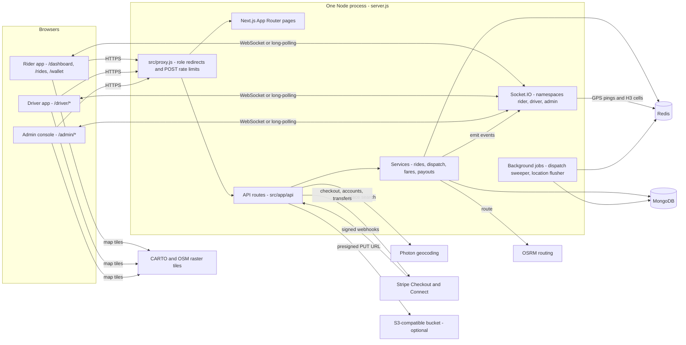
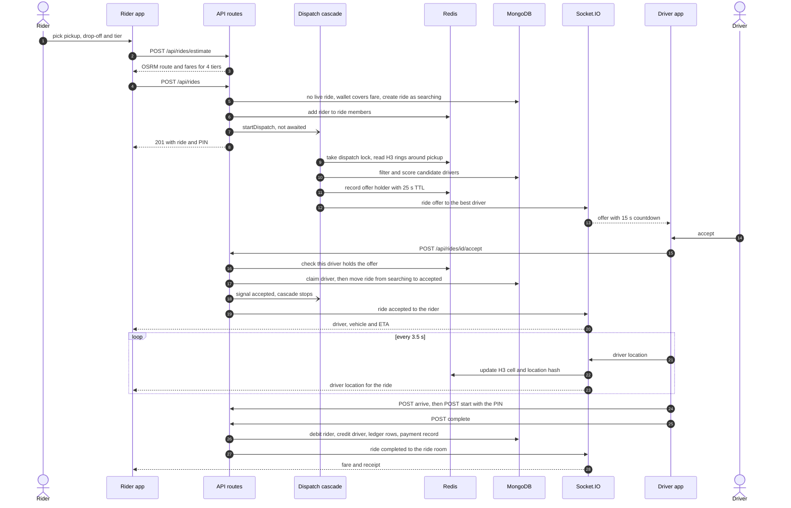

# Kova architecture

Kova is a ride-hailing platform with three apps in one Next.js 16 codebase:
a rider app, a driver app and an admin console. A single Node process
(`server.js`) serves the Next.js pages and API routes and hosts the Socket.IO
server, so API routes can push realtime events directly. MongoDB holds the
durable data; Redis holds short-lived state that can be rebuilt (driver
positions, the H3 driver index, dispatch locks, ride-room membership).

This document covers the parts and how they talk. The data model, the flows
step by step, limits and security are in [SYSTEM-DESIGN.md](SYSTEM-DESIGN.md).

## The parts at a glance

## Process model

| Piece | File | What it does |
| --- | --- | --- |
| Custom server | `server.js` | Creates the HTTP server, hands requests to Next.js, starts Socket.IO on the same port, verifies socket JWTs, handles driver GPS pings, and stores the `Server` instance on `global.io`. |
| Request proxy | `src/proxy.js` | Next.js 16's proxy (the file formerly called middleware). Redirects signed-out users to `/login`, sends each role to its own home, and rate-limits three public POST endpoints in process memory. |
| Background jobs | `src/instrumentation.js` | Runs once at server start on the Node runtime and starts two timers: the dispatch sweeper (`src/lib/realtime/dispatch.js`) and the location flusher (`src/lib/realtime/location-flusher.js`). |
| Emit helpers | `src/lib/realtime/emit.js` | Lets API routes and services emit to a user, a ride room or the admin feed through `global.io`; every helper is a no-op when the socket server is not running (for example during `next build`). Also holds the in-process ride event bus that the dispatch loop listens on. |

Because sockets, the dispatch loop, the ride bus and the rate limiter all live
in this one process, the README says to run exactly one instance. See
"How it scales" in SYSTEM-DESIGN.md.

## Pages

| Area | Routes | Notes |
| --- | --- | --- |
| Public | `/`, `/login`, `/signup`, `/contact`, `/terms`, `/privacy` | Marketing page, sign-in and sign-up (as rider or driver), contact form, legal pages. `sitemap.js` and `robots.js` generate SEO files. |
| Rider | `/dashboard`, `/rides`, `/rides/[id]`, `/wallet`, `/profile` | Booking with live tracking and chat, ride history and receipts, wallet top-ups and ledger, profile and avatar. |
| Driver | `/driver/dashboard`, `/driver/earnings`, `/driver/wallet`, `/driver/trips`, `/driver/profile` | Go online, receive offers, run the trip; earnings and Stripe payouts; wallet; trip history; vehicle onboarding. |
| Admin | `/admin/dashboard`, `/admin/rides`, `/admin/drivers`, `/admin/users`, `/admin/pricing`, `/admin/support` | KPIs and a live fleet map, ride list, driver approve and suspend, user list, pricing rules, contact-form inbox. |

All pages are client components that call the API routes with `fetch`. Maps
use MapLibre GL (`src/components/maps/MapView.jsx`) with keyless CARTO light
raster tiles built on OpenStreetMap data. Place search uses
`src/components/maps/PlaceSearch.jsx` against `/api/geo/search`.

## API routes

Every route re-checks the session with `requireAuth(roles)` from
`src/lib/auth/helpers.js`, except the public ones marked below.

| Method and path | Who | Purpose |
| --- | --- | --- |
| `GET, POST /api/auth/[...nextauth]` | public | NextAuth v5 handlers: CSRF token, credentials sign-in, session, sign-out. |
| `POST /api/auth/signup` | public | Create a rider or driver account (drivers also get a `Driver` profile). |
| `GET /api/auth/socket-token` | signed in | Short-lived JWT for the Socket.IO handshake; drivers' tokens carry their driver profile id. |
| `GET, PATCH /api/users/me` | signed in | Read or update name, phone, email, avatar URL and saved places. |
| `POST, DELETE /api/users/me/avatar` | signed in | Upload a picture (resized to a 256 px JPEG and stored inline) or remove it. |
| `POST /api/rides/estimate` | signed in | Route plus fares for all four vehicle tiers. |
| `GET /api/rides` | rider, driver | Own ride history, paginated. |
| `POST /api/rides` | rider | Book a ride; starts dispatch. |
| `GET /api/rides/active` | rider, driver | The current live ride, used to resume after a reload or reconnect. |
| `GET /api/rides/[id]` | participants, admin | Ride detail with driver and rider summary. |
| `POST /api/rides/[id]/accept` | driver | Accept the offer this driver holds. |
| `POST /api/rides/[id]/decline` | driver | Decline an offer; the cascade moves on. |
| `POST /api/rides/[id]/arrive` | driver | Mark arrival at the pickup. |
| `POST /api/rides/[id]/start` | driver | Start the trip with the rider's 4-digit PIN. |
| `POST /api/rides/[id]/complete` | driver | End the trip and settle the fare. |
| `POST /api/rides/[id]/cancel` | rider, driver | Cancel; rules differ by role and status. |
| `POST /api/rides/[id]/rate` | rider, driver | Rate a completed ride once per side. |
| `POST /api/rides/[id]/messages` | rider, driver | In-ride chat message, stored and relayed. |
| `GET, PATCH /api/drivers/me` | driver | Driver profile; PATCH saves vehicle details and licence number. |
| `POST /api/drivers/me/status` | driver | Go online (with a location) or offline. |
| `GET /api/drivers/me/earnings` | driver | Today and this week, recent trips, ledger. |
| `GET, POST /api/drivers/me/payouts` | driver | Payout status; POST starts Stripe Connect onboarding or cashes out. |
| `GET /api/drivers/nearby` | signed in | Available drivers around a point for the map (no user ids or names in the payload). |
| `GET /api/geo/search` | signed in | Place autocomplete or reverse geocode through Photon. |
| `GET, POST /api/wallet` | signed in | Balance and ledger; POST is the demo top-up, refused once Stripe is configured. |
| `GET, POST /api/wallet/checkout` | signed in | Create a Stripe Checkout session for a top-up, or verify one on return and credit it. |
| `POST /api/webhooks/stripe` | Stripe signature | `checkout.session.completed` credits top-ups, `account.updated` syncs payout status. |
| `GET /api/admin/overview` | admin | KPIs, recent rides, 7-day revenue, status breakdown, open support count. |
| `GET /api/admin/rides` | admin | All rides, filter by status. |
| `GET, PATCH /api/admin/drivers` | admin | Driver list or approval queue; approve or suspend. |
| `GET /api/admin/users` | admin | User list with role filter and name search (read-only). |
| `GET, PUT /api/admin/pricing` | admin | Pricing rules; PUT upserts one rule per vehicle type and city. |
| `GET, PATCH /api/admin/support` | admin | Contact-form inbox; resolve or reopen. |
| `POST /api/contact` | public | Contact form with honeypot and per-IP limits. |
| `POST /api/upload/presigned` | signed in | Presigned upload URL for the optional bucket; answers 503 until storage is configured. No page calls it yet. |
| `GET /api/health` | public | 200 when MongoDB and Redis are both reachable, 503 otherwise. |

## Services

| Module | Responsibility |
| --- | --- |
| `src/lib/services/ride-service.js` | Create, accept, decline, arrive, start, complete, cancel, rate, chat and the active-ride query. Every status change is an atomic `findOneAndUpdate` guarded on the expected status. |
| `src/lib/realtime/dispatch.js` | The offer cascade, offer holder checks, the in-process signal bus and the stuck-ride sweeper. |
| `src/lib/services/ride-matcher.js` | Driver search and scoring: H3 candidates from Redis first, MongoDB `$geoNear` as the fallback. |
| `src/lib/services/h3-redis.js`, `h3-spatial.js` | H3 cell index for drivers and the demand log used for surge. |
| `src/lib/services/fare-calculator.js` | Fare from pricing rules (or built-in defaults), surge cap, platform fee and driver share. |
| `src/lib/services/routing.js` | OSRM driving route with a straight-line estimate as fallback. |
| `src/lib/services/stripe.js` | Lazy Stripe client and the idempotent wallet credit for paid Checkout sessions. |
| `src/lib/services/payouts.js` | Stripe Connect Express onboarding, payout status and cash-out. |
| `src/lib/storage.js` | Optional S3-compatible client configured from `STORAGE_*` variables. |

## Data stores

- **MongoDB** through Mongoose (`src/lib/db/mongodb.js`, cached connection,
  pool of 10). Seven collections: `users`, `drivers`, `rides`, `payments`,
  `wallettransactions`, `pricingrules`, `contactmessages`. Schemas live in
  `src/lib/db/models/`.
- **Redis** through ioredis (`src/lib/db/redis.js` for the Next.js side; a
  separate lazy client in `server.js` for socket handlers, with the same key
  layout). Keys: the H3 driver index, driver location hashes, the demand log,
  ride membership sets, offer and dispatch locks, and the contact-form counter.
  Nothing in Redis needs to survive a restart.

## Realtime

Clients connect through `src/context/SocketProvider.jsx`: it fetches a token
from `/api/auth/socket-token` and opens the namespace that matches the user's
role (`/rider`, `/driver` or `/admin`), WebSocket first with long-polling as
the fallback, reconnecting forever and refreshing the token on auth errors.
`server.js` rejects a token for the wrong namespace. Each socket joins
`user:{id}`; ride participants are also joined to `ride:{rideId}`.

| Direction | Event | Sent by | Received by |
| --- | --- | --- | --- |
| client to server | `driver:location` | driver app every 3.5 s while online or on a trip | `server.js`: Redis index, relay to the ride room and admins |
| client to server | `driver:offline` | driver app | `server.js`: remove from the H3 index |
| client to server | `ride:subscribe` | rider and driver apps on (re)connect | `server.js`: joins the ride room only if the user is in `ride:members:{rideId}` |
| server to driver | `ride:offer`, `ride:offer-expired`, `ride:offer-withdrawn` | dispatch cascade | the offered driver |
| server to rider | `ride:searching-update`, `ride:accepted`, `ride:no-drivers`, `ride:driver-cancelled` | dispatch and ride service | the rider |
| server to ride room | `ride:driver-arrived`, `ride:started`, `ride:completed`, `ride:message` | ride service | rider and driver |
| server to rider room | `driver:location` | `server.js` relay | the rider of that ride |
| server to driver | `ride:cancelled` | ride service when the rider cancels | the assigned driver |
| server to admin | `ride:updated`, `driver:status-changed`, `driver:location` | ride service, status route, `server.js` | every admin socket |

## Sign-in

NextAuth v5 with a single credentials provider (`src/lib/auth/config.js`):
username and password, checked with bcrypt against `users.passwordHash`.
Sessions are JWTs (30 days) carrying the user id, role, username and avatar.
Page access is enforced in `src/proxy.js`; API access is enforced again in each
route. Sockets use a separate 12-hour JWT signed with the same
`NEXTAUTH_SECRET`. There is no OAuth, email login, password reset or
two-factor sign-in.

## Payments

Riders pay from a prepaid wallet. When `STRIPE_SECRET_KEY` is set, top-ups go
through Stripe Checkout and are credited by the webhook or by the return page,
whichever arrives first. Drivers are credited their share in the same wallet
and cash out to a bank account through Stripe Connect Express transfers. When
Stripe is not configured, the wallet hands out instant demo credits and
payouts are disabled. Kova never sees card or bank details.

## Storage

Profile pictures are resized with `sharp` to a 256 px JPEG and stored as a
`data:` URI on the user document, so they need no bucket. The optional
S3-compatible bucket is used only by `/api/upload/presigned`, which no page
calls yet.

## Outside services

| Service | Used for | Configured by | When it is down |
| --- | --- | --- | --- |
| OSRM | Driving route, distance and duration | `OSRM_URL` (defaults to the public demo server) | Straight-line distance x 1.35 at 25 km/h |
| Photon | Place search and reverse geocoding | `PHOTON_URL` (defaults to the public instance) | Search returns 502 with an empty list |
| CARTO and OpenStreetMap tiles | Map background in the browser | hard-coded in `MapView.jsx` | Map renders without tiles |
| Stripe | Checkout top-ups, Connect payouts, webhooks | `STRIPE_SECRET_KEY`, `STRIPE_WEBHOOK_SECRET` | Top-up or payout returns an error; the wallet is not changed |
| S3-compatible bucket | Presigned uploads | `STORAGE_*` | Endpoint answers 503 |

## The main request: book a ride to drop-off

## Deployment shape

- `npm run build` then `npm start` runs `node server.js` in production mode.
  `next.config.mjs` sets `output: 'standalone'`, security headers and
  `Cache-Control: no-store` on `/api/*`.
- The `Dockerfile` builds a standalone image (Node 20 Alpine, non-root user)
  and starts `server.js`. `NEXT_PUBLIC_APP_URL` must be passed as a build
  argument because it is inlined into the browser bundle.
- `docker-compose.yml` starts MongoDB 7 and Redis 7 for local development.
- `scripts/seed.js` creates an admin, a demo rider, five approved demo drivers
  and pricing rules; `scripts/simulate-driver.js` signs in as a demo driver and
  runs trips automatically.
