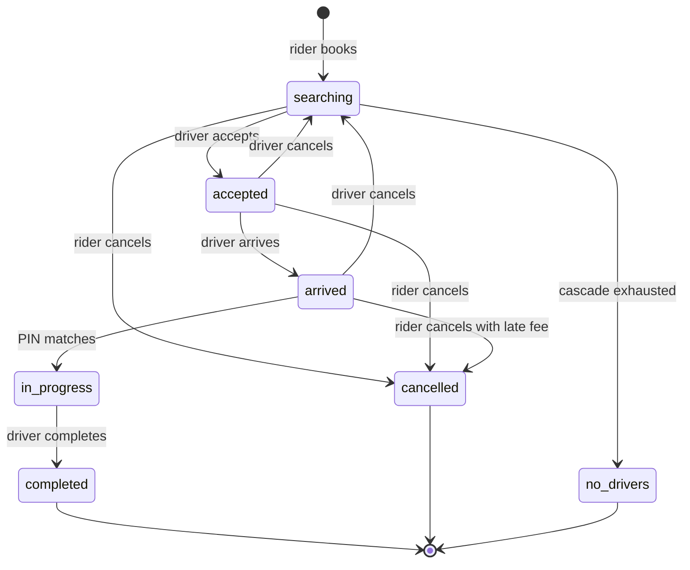

# Kova system design

How Kova stores data, how a ride moves through the system, who may do what,
the limits in the code, how it behaves when something fails, and how it would
scale. Everything here is read from the code; file paths point at the source.
For the parts and diagrams of the whole system see
[ARCHITECTURE.md](ARCHITECTURE.md).

## Data model

MongoDB through Mongoose. Every schema has `timestamps: true`, so each document
also has `createdAt` and `updatedAt` (Date). Coordinates are GeoJSON
`[lng, lat]`.

### `users` (`src/lib/db/models/User.js`)

| Field | Type | Notes |
| --- | --- | --- |
| `username` | String | Required, unique, lowercase, 3 to 30 chars of `a-z 0-9 _ .` |
| `passwordHash` | String | Required, bcrypt hash, excluded from queries by default (`select: false`) |
| `name` | String | Required, up to 100 chars |
| `phone` | String | Optional, unique when set (sparse index) |
| `email` | String | Optional, lowercase, unique when set (sparse index) |
| `avatar` | String | `data:image/jpeg;base64,...` from the avatar upload, or a URL, or empty |
| `role` | String | `rider`, `driver` or `admin`; default `rider` |
| `wallet.balance` | Number | Default 0. The schema says `min: 0`, but balances are changed with `$inc`, which skips validators, so a balance can go negative on purpose (see Settle) |
| `wallet.currency` | String | Default `USD` |
| `rating.average` | Number | 0 to 5, default 5 |
| `rating.count` | Number | Default 0 |
| `isActive` | Boolean | Default true; sign-in is refused when false |
| `lastLoginAt` | Date | Set on each sign-in |
| `savedPlaces[]` | Array | `label` String, `address` String, `location` GeoJSON Point; at most 10 through the API |

Indexes: `username` (unique), `phone` and `email` (unique, sparse), `role`.

### `drivers` (`src/lib/db/models/Driver.js`)

One driver profile per driver user.

| Field | Type | Notes |
| --- | --- | --- |
| `userId` | ObjectId to `users` | Required, unique |
| `license.number` | String | Saved from the driver profile page |
| `license.expiry` | Date | Not set by any route |
| `license.imageUrl` | String | Not set by any route |
| `license.verified` | Boolean | Default false; the seed sets true for demo drivers |
| `vehicle.make`, `model`, `color`, `plate` | String | Required by the onboarding API; a plate is needed to go online |
| `vehicle.year` | Number | 1990 to 2030 through the API |
| `vehicle.type` | String | `economy`, `comfort`, `premium` or `xl` |
| `vehicle.imageUrl` | String | Not set by any route |
| `documents[]` | Array | `type` (`license`, `insurance`, `registration`, `background_check`, `profile_photo`), `url` String, `verified` Boolean, `uploadedAt`, `reviewedAt` Date, `rejectionReason` String. Declared but no route writes it |
| `payouts.stripeAccountId` | String | Stripe Connect Express account id |
| `payouts.detailsSubmitted` | Boolean | Synced from Stripe |
| `payouts.payoutsEnabled` | Boolean | Synced from Stripe; required to cash out |
| `payouts.lastPayoutAt` | Date | Set on each successful cash-out |
| `isOnline` | Boolean | Default false |
| `isApproved` | Boolean | Default false; set at sign-up from `DRIVER_AUTO_APPROVE`, changed by admins |
| `location` | GeoJSON Point | Last known position, written by the location flusher |
| `lastLocationUpdate` | Date | Timestamp of that position |
| `currentRideId` | ObjectId to `rides` | Null when free; used as an atomic claim so a driver cannot hold two rides |
| `stats.totalTrips` | Number | Incremented on completion |
| `stats.totalEarnings` | Number | Incremented on completion |
| `stats.totalOnlineHours` | Number | Declared, never updated |
| `stats.acceptanceRate` | Number | 0 to 100, default 100 |
| `stats.cancellationRate` | Number | 0 to 100, default 0; incremented by 1 per driver cancellation |
| `stats.averageRating` | Number | 0 to 5, default 5; updated when a rider rates |
| `h3Cell` | String | Last H3 cell (resolution 9), indexed |
| `h3Resolution` | Number | Default 9 |

Indexes: `location` (2dsphere), `{isOnline, isApproved, vehicle.type}`,
`{h3Cell, isOnline, isApproved}`, `currentRideId`, `userId` (unique). A
virtual `user` populates the user document.

### `rides` (`src/lib/db/models/Ride.js`)

| Field | Type | Notes |
| --- | --- | --- |
| `riderId` | ObjectId to `users` | Required |
| `driverId` | ObjectId to `users` | Set on accept, cleared if the driver cancels |
| `driverProfileId` | ObjectId to `drivers` | Same lifecycle as `driverId` |
| `status` | String | `searching`, `accepted`, `arrived`, `in_progress`, `completed`, `cancelled`, `no_drivers` |
| `pickup.address` | String | Required |
| `pickup.location` | GeoJSON Point | Required |
| `pickup.arrivedAt` | Date | Set when the driver arrives |
| `dropoff.address` | String | Required |
| `dropoff.location` | GeoJSON Point | Required |
| `route.distanceMeters`, `route.durationSeconds` | Number | From OSRM or the fallback estimate |
| `route.geometry` | Array of `[lng, lat]` | OSRM line, or two points for the estimate |
| `route.actualDurationSeconds` | Number | Set on completion |
| `route.actualDistanceMeters` | Number | Declared, never set |
| `vehicleType` | String | `economy`, `comfort`, `premium` or `xl` |
| `fare.baseFare`, `distanceFare`, `timeFare`, `surgeFare`, `bookingFee`, `platformFee`, `driverEarnings`, `total`, `estimatedTotal` | Number | Computed at booking |
| `fare.surgeMultiplier` | Number | Default 1.0 |
| `fare.tip`, `fare.discount` | Number | Declared, never set |
| `fare.cancellationFee` | Number | Set on a late rider cancel |
| `fare.currency` | String | `USD` |
| `payment.method` | String | `wallet` for every new ride; `cash` is kept in the enum for older records |
| `payment.status` | String | `pending`, `captured`, `failed`, `refunded`, `waived` |
| `pin` | String | 4-digit code the rider gives the driver at pickup |
| `rating.byRider`, `rating.byDriver` | Number | 1 to 5 |
| `rating.riderComment`, `rating.driverComment` | String | Up to 500 chars |
| `messages[]` | Array | `from` (`rider` or `driver`), `text` String up to 500, `at` Date |
| `dispatch.offeredTo[]`, `dispatch.declinedBy[]` | ObjectId to `drivers` | Drivers already offered or who declined |
| `dispatch.offersSent` | Number | Offers made so far |
| `timeline[]` | Array | `status` String, `timestamp` Date, optional `location` Point and `note` String |
| `cancelledBy` | String | `rider`, `driver` or `system` |
| `cancellationReason` | String | Free text, up to 300 chars through the API |
| `startedAt`, `completedAt` | Date | Trip start and end |

Indexes: `{riderId, createdAt}`, `{driverId, createdAt}`, `{status, createdAt}`,
`pickup.location` (2dsphere). A virtual `durationMinutes` is computed from
`startedAt` and `completedAt`.

### `payments` (`src/lib/db/models/Payment.js`)

One record per completed ride, written at settlement. No route reads it yet.

| Field | Type | Notes |
| --- | --- | --- |
| `rideId` | ObjectId to `rides` | Required |
| `riderId` | ObjectId to `users` | Required |
| `driverId` | ObjectId to `users` | |
| `amount` | Number | Required, the fare total |
| `currency` | String | Default `usd` |
| `platformFee`, `driverPayout` | Number | Split of the fare |
| `status` | String | `pending`, `processing`, `succeeded`, `failed`, `refunded`; settlement writes `succeeded` |
| `method` | String | `wallet` or `cash`; settlement writes `wallet` |
| `refundAmount` | Number | Default 0, never set |
| `refundReason` | String | Never set |
| `metadata` | Mixed | Default `{}` |

Indexes: `rideId`, `{riderId, createdAt}`, `{driverId, createdAt}`, `status`.

### `wallettransactions` (`src/lib/db/models/WalletTransaction.js`)

The ledger behind every wallet balance change.

| Field | Type | Notes |
| --- | --- | --- |
| `userId` | ObjectId to `users` | Required |
| `type` | String | `topup`, `ride_payment`, `ride_earning`, `refund`, `cancellation_fee`, `payout`, `commission`. The code writes all but `refund` and `commission` |
| `amount` | Number | Required; positive is a credit, negative a debit |
| `balanceAfter` | Number | Required, the balance right after this entry |
| `rideId` | ObjectId to `rides` | For ride payments, earnings and fees |
| `note` | String | Up to 200 chars |
| `ref` | String | External id (Stripe Checkout session id or transfer id); unique when set, which makes card credits idempotent |

Indexes: `{userId, createdAt}`, `ref` (unique, sparse).

### `pricingrules` (`src/lib/db/models/PricingRule.js`)

| Field | Type | Notes |
| --- | --- | --- |
| `vehicleType` | String | Required, one of the four tiers |
| `city` | String | Required; the fare code only ever reads `default` |
| `baseFare`, `perKmRate`, `perMinRate`, `minimumFare` | Number | Required |
| `bookingFee` | Number | Default 1.0 |
| `platformCommission` | Number | Percent, 0 to 50 |
| `surgeMultiplierCap` | Number | 1 to 10, default 3 |
| `isActive` | Boolean | Inactive rules are ignored |

Index: `{vehicleType, city}` unique. If no active rule exists the built-in
defaults in `src/lib/services/fare-calculator.js` apply (8 to 10 percent
commission, the same numbers the seed writes).

### `contactmessages` (`src/lib/db/models/ContactMessage.js`)

| Field | Type | Notes |
| --- | --- | --- |
| `name` | String | Required, up to 100 |
| `email` | String | Required, lowercase, up to 200 |
| `topic` | String | `general`, `ride_issue`, `driver_support`, `payments`, `safety`, `data_request` |
| `message` | String | Required, up to 2000 |
| `userId` | ObjectId to `users` | Set when the sender was signed in |
| `status` | String | `open` or `resolved` |
| `resolvedAt` | Date | Set when resolved |

Index: `{status, createdAt}`.

### Redis keys

None of these need to survive a restart; TTLs clean up after drivers who
vanish.

| Key | Type | TTL | Written by |
| --- | --- | --- | --- |
| `h3:drivers:{cell}` | Set of driver profile ids in an H3 resolution-9 cell | 300 s | `server.js`, status route |
| `h3:driver:cell:{profileId}` | String, the driver's current cell | 300 s | same |
| `driver:loc:{profileId}` | Hash: `lat`, `lng`, `heading`, `ts`, `h3`, `flushed` | 600 s | `server.js` |
| `h3:demand:{cell}` | Sorted set of booking attempts at resolution 7, scored by time | 600 s | ride matcher |
| `ride:members:{rideId}` | Set of user ids allowed in the ride's socket room | 24 h | ride service |
| `ride:offer:{rideId}` | String, the driver profile id holding the current offer | 25 s | dispatch |
| `ride:dispatch:{rideId}` | Lock so only one cascade runs per ride | 300 s | dispatch |
| `contact:rl:{ip}` | Counter for the contact form | 1 h | contact route |

## Ride lifecycle

## Main flows

### Sign-up, sign-in and socket auth

1. `POST /api/auth/signup` validates with zod (name, username, password of 8
   to 128 chars, matching confirmation, role `rider` or `driver`), rejects a
   taken username, hashes the password with bcrypt (cost 12) and creates the
   user. A driver also gets a `drivers` document, approved at once unless
   `DRIVER_AUTO_APPROVE=false`. Admins are only created by `scripts/seed.js`.
2. Sign-in posts to NextAuth's credentials callback. `authorize` loads the
   user by username, compares the bcrypt hash, refuses inactive accounts,
   stamps `lastLoginAt` and returns id, username, name, role and avatar, which
   go into a 30-day JWT session cookie.
3. The app shell fetches `GET /api/auth/socket-token`, a 12-hour JWT with the
   user id, role and name (plus the driver profile id for drivers), and
   connects to the namespace for that role. `server.js` verifies the token
   and the namespace, then joins the socket to `user:{id}`.

### Driver goes online and streams GPS

1. The driver saves vehicle details (`PATCH /api/drivers/me`).
2. `POST /api/drivers/me/status` with `online: true` and a browser location
   checks: approved, a plate on file, a location given, and a wallet balance
   not below -25. It then sets `isOnline`, saves the position and seeds the
   H3 index. Admins get `driver:status-changed`.
3. While online or on a trip, `src/hooks/useDriverState.js` watches the
   browser's position and emits `driver:location` at most every 3.5 s.
   `server.js` updates the H3 cell set, the cell pointer and the location hash
   in one Redis pipeline, relays the point to the ride room (if the driver is
   a member) and to every admin.
4. Every 10 s the location flusher scans `driver:loc:*` (up to 2000 keys),
   bulk-writes unflushed positions and cells to `drivers`, and marks them
   flushed. GPS pings never write to MongoDB directly.
5. Going offline is refused during a trip; otherwise `isOnline` is cleared and
   the driver is removed from the H3 index. A socket disconnect also removes
   the driver from the index.

### Estimate

`POST /api/rides/estimate` asks OSRM for the route (6 s timeout; on failure a
straight-line distance x 1.35 at 25 km/h), computes surge once for the pickup,
then prices all four tiers:

1. Pricing rule for the tier and city `default`, or the built-in defaults.
2. Subtotal = base fare + km x per-km rate + minutes x per-minute rate.
3. Surge: demand is booking attempts in the last 10 minutes within one ring of
   the resolution-7 cell; supply is indexed drivers within two rings of the
   resolution-9 cell. Demand/supply above 1 gives 1.25x, above 1.5 gives
   1.75x, above 2 gives 2.0x, above 3 (or demand with zero supply) gives 2.5x,
   capped by the rule's `surgeMultiplierCap`.
4. Minimum fare is applied, then the booking fee is added to give the total.
5. Platform fee = total x commission percent; the driver gets the rest.

### Book

`POST /api/rides` (riders only), in `createRide`:

1. Refuse if the rider already has a ride in `searching`, `accepted`,
   `arrived` or `in_progress` (409).
2. Recompute the route on the server, refuse trips under 100 m or over 200 km.
3. Compute the fare for the chosen tier.
4. Refuse if the wallet balance is negative or below the fare total (402).
5. Draw a 4-digit PIN with `crypto.randomInt`.
6. Create the ride as `searching` with its first timeline entry, add the
   rider to `ride:members`, join the rider's sockets to the ride room, notify
   admins, and start dispatch without awaiting it.

### Dispatch

`startDispatch` in `src/lib/realtime/dispatch.js`:

1. Take `ride:dispatch:{rideId}` with `SET NX` (300 s). If another cascade
   holds it, return. If Redis is down, continue without the lock.
2. Up to 8 times: reload the ride and stop unless it is still `searching`.
3. Find the best driver, excluding drivers already offered:
   - record the booking in the demand log;
   - fast path: expand H3 rings around the pickup (up to 10 rings for the
     15 km dispatch radius) until at least 3 driver ids are found, then load
     those drivers from MongoDB that are online, approved, free and of the
     right tier;
   - fallback: MongoDB `$geoNear` at 2 km, then 5 km, then 15 km;
   - score = 40 x closeness + 25 x rating/5 + 20 x acceptance/100 +
     15 x (1 - cancellation/100), take the highest.
4. No candidate: mark the ride `no_drivers` and tell the rider.
5. Set `ride:offer:{rideId}` to that driver (25 s TTL), add them to
   `dispatch.offeredTo`, send `ride:offer` (earnings, distances, ETA, rider
   name and rating, 15 s to answer) and tell the rider how many offers have
   gone out.
6. Wait up to 16 s for a signal on the in-process ride bus. Accepted: stop.
   Cancelled: withdraw the offer and stop. Declined or timed out: clear the
   offer, record the outcome, add decliners to `dispatch.declinedBy`, and go
   to the next driver.
7. After 8 offers without an accept, mark the ride `no_drivers`.

The sweeper runs every 60 s and restarts dispatch for up to 20 rides that have
been `searching` without an update for 90 s, which covers a server restart in
the middle of a cascade.

### Accept, arrive, start

1. **Accept** (`acceptRide`): the driver must be approved and must hold the
   offer in Redis (if the key has expired, the atomic updates below decide).
   The driver is claimed first (`currentRideId: null` to the ride id), then
   the ride is claimed (`searching` to `accepted`); if the ride claim loses,
   the driver claim is rolled back. The offer is cleared, the cascade is
   signalled, the driver joins the ride room and membership set, and the
   rider gets `ride:accepted` with the driver, vehicle and an ETA at 25 km/h.
2. **Arrive**: `accepted` to `arrived`, stamps `pickup.arrivedAt`, emits
   `ride:driver-arrived` to the ride room.
3. **Start**: the ride must be `arrived` and the PIN must match; `arrived` to
   `in_progress`, stamps `startedAt`, emits `ride:started`.

Arrive, start and complete are each one `findOneAndUpdate` filtered on the
driver and the expected current status, and accept is guarded on `searching`,
so a repeated or late request gets a 409 instead of a second transition.

### Complete and settle

`completeRide`:

1. `in_progress` to `completed`, stamp `completedAt`, record the actual
   duration.
2. Debit the rider's wallet by the fare total with `$inc` and write a
   `ride_payment` ledger row. The balance may go negative if it dropped after
   booking; the rider then cannot book again until they top up.
3. Credit the driver's wallet with `driverEarnings` and write a `ride_earning`
   row. The driver is paid even when the rider ends up short.
4. Mark `payment.status` captured and write a `payments` record.
5. Free the driver (`currentRideId: null`), add to trip count and earnings.
6. Emit `ride:completed` (with a `shortfall` flag), take both users out of
   the ride room and delete the membership set.

### Cancel

- **Rider**, while `searching`, `accepted` or `arrived`: the cascade is
  signalled to stop. If the driver had already arrived, a 3.00 fee is charged
  to the rider (ledger `cancellation_fee`) and 80 percent of it (2.40) is
  credited to the driver. Otherwise the payment is marked `waived`. The
  driver is freed and told with `ride:cancelled`.
- **Driver**, while `accepted` or `arrived`: the driver is freed, their
  `cancellationRate` goes up by 1, the ride goes back to `searching` with the
  driver in `declinedBy`, the rider gets `ride:driver-cancelled`, and dispatch
  starts again.

### Rate and chat

- Each side may rate a completed ride once (1 to 5, optional comment). The
  other party's `users.rating` running average is updated; a rider's rating
  of a driver also updates `drivers.stats.averageRating`.
- `POST /api/rides/[id]/messages` appends to `rides.messages` while the ride
  is `accepted`, `arrived` or `in_progress` and relays `ride:message` to the
  ride room.

### Wallet top-ups

- **Stripe configured:** `POST /api/wallet/checkout` (5 to 1000) creates a
  Checkout session with the user id in its metadata. The wallet is credited by
  whichever arrives first: the `checkout.session.completed` webhook, or
  `GET /api/wallet/checkout?session_id=...` from the return page, which first
  checks that the session belongs to the caller. `creditCheckoutSession`
  only credits paid sessions, skips sessions already in the ledger, and if two
  paths race, the unique `ref` index rejects the second ledger row and that
  path undoes its credit.
- **Stripe not configured:** `POST /api/wallet` credits up to 1000 at once
  (demo credits). It returns 409 once Stripe is configured.

### Driver payouts

1. `POST /api/drivers/me/payouts` with `action: onboard` creates (or reuses) a
   Stripe Connect Express account (US, individual, transfers capability) and
   returns a hosted onboarding link back to `/driver/earnings`.
2. Payout readiness is synced from the `account.updated` webhook and refreshed
   from Stripe whenever the driver loads the payout status.
3. `action: cashout` requires payouts enabled and an amount of at least 5 and
   no more than the balance. The wallet is debited first with a guarded
   `$inc`, then a Stripe transfer is created with an idempotency key built from
   driver, amount and minute. If Stripe fails, the debit is reversed. On
   success a `payout` ledger row records the transfer id.

### Profile, contact and admin

- `PATCH /api/users/me` updates name, phone, email, avatar URL and up to 10
  saved places; empty strings unset sparse unique fields. The avatar upload
  allows JPEG, PNG, WebP and HEIC/HEIF types up to 5 MB, rejects files the
  `sharp` resizer cannot read, and stores a 256 px JPEG.
- `POST /api/contact` is public: zod validation, a hidden `company` honeypot,
  a Redis limit of 5 per hour per IP (on top of the proxy limit), and the
  signed-in user id when there is one. Admins resolve or reopen messages.
- Admins approve or suspend drivers (suspending also sets them offline), edit
  pricing rules, and watch KPIs that refresh every 30 s and on socket events.

## Roles and permissions

| Capability | Rider | Driver | Admin | Public |
| --- | --- | --- | --- | --- |
| Marketing, legal, contact form, sign-up, sign-in, health check | yes | yes | yes | yes |
| Own profile, avatar, wallet, place search, nearby drivers, estimates | yes | yes | yes | |
| Book a ride | yes | | | |
| Rider pages `/dashboard`, `/rides`, `/wallet` | yes | redirected | redirected | to `/login` |
| Driver pages and `/api/drivers/me/*` | | yes | | |
| Receive offers, accept, decline, arrive, start, complete | | yes | | |
| Cancel, rate, chat, active ride, ride history | yes | yes | | |
| Read one ride (`GET /api/rides/[id]`) | if participant | if participant | yes | |
| Admin pages and `/api/admin/*` | | | yes | |
| Admin socket feed (all driver positions, ride updates) | | | yes | |

Pages are guarded in `src/proxy.js`; every API route calls `requireAuth` with
its allowed roles; sockets are bound to the namespace named in their token.
The role is copied from the user document into the session at sign-in. There
is no admin screen or API for changing a user's role, and admin accounts are
created only by the seed script.

## Limits

| Limit | Value | Where |
| --- | --- | --- |
| Session lifetime | 30 days | `src/lib/auth/config.js` |
| Socket token lifetime | 12 hours | `src/lib/auth/helpers.js` |
| Password length | 8 to 128 | `src/app/api/auth/signup/route.js` |
| Sign-up attempts | 15 per hour per IP | `src/proxy.js` |
| Sign-in attempts | 30 per 10 minutes per IP | `src/proxy.js` |
| Contact form | 5 per hour per IP (proxy) and 5 per hour per IP (Redis) | `src/proxy.js`, `src/app/api/contact/route.js` |
| Live rides per rider | 1 | `ride-service.js` |
| Trip length | 100 m to 200 km | `ride-service.js` |
| Offers per ride | 8 | `dispatch.js` |
| Time to answer an offer | 15 s shown, 16 s on the server | `dispatch.js` |
| Dispatch radius | 15 km | `dispatch.js` |
| GPS ping interval | 3.5 s | `src/hooks/useDriverState.js` |
| Location flush | every 10 s, up to 2000 drivers | `location-flusher.js` |
| Driver index expiry | 300 s without a ping | `server.js`, `h3-redis.js` |
| Surge window | 10 minutes | `h3-redis.js` |
| Late cancel fee | 3.00, 80 percent to the driver | `ride-service.js` |
| Lowest balance to go online | -25 | `src/app/api/drivers/me/status/route.js` |
| Card top-up | 5 to 1000 | `src/app/api/wallet/checkout/route.js` |
| Demo top-up | up to 1000 | `src/app/api/wallet/route.js` |
| Cash-out | at least 5, at most 10000 per request and no more than the balance | `payouts.js`, payouts route |
| Chat message, rating comment | 500 chars | ride routes |
| Avatar upload | 5 MB in, 256 x 256 JPEG stored | avatar route |
| Presigned upload | 10 MB (as reported by the client), URL valid 1 hour | presigned route |
| Admin list pages | 50 per page | admin routes |
| Nearby drivers | 20 km radius, 20 results | nearby route |
| OSRM and Photon timeouts | 6 s and 5 s | `routing.js`, geo route |
| MongoDB pool | 10 connections, 5 s server selection | `src/lib/db/mongodb.js` |

Currency is USD throughout; Stripe accounts are created for the US.

## Failure handling

| Failure | What happens |
| --- | --- |
| Redis down | Dispatch runs without its lock; the offer-holder check lets the atomic MongoDB updates decide; matching falls back to `$geoNear` on positions last flushed to MongoDB; surge drops to 1.0; ride-room membership checks fail open so riders still get updates; the contact form skips its Redis counter. `/api/health` reports 503. |
| MongoDB down | API routes return 500; `/api/health` reports 503; the cached connection promise is reset so the next request retries. |
| OSRM down or slow | Straight-line estimate, so booking still works with a two-point route line. |
| Photon down | Place search returns 502 with an empty list; the UI shows an error state. |
| Server restart mid-ride | The sweeper re-dispatches stuck `searching` rides; clients reconnect, call `/api/rides/active` and re-subscribe to the ride room. |
| Driver disappears | Their index entries expire after 300 s; a socket disconnect removes them at once. |
| Two drivers accept | Only the offer holder passes the Redis check, and the `searching` to `accepted` update can succeed only once. |
| Double booking or double submit | One live ride per rider; dispatch lock per ride; status-guarded transitions return 409. |
| Stripe webhook and return page race | Unique `ref` on the ledger; the losing path reverses its credit. |
| Stripe transfer fails | Driver's debit is reversed and the error message is returned. |
| Stripe webhook handler error | Returns 500 so Stripe retries. |
| Rider balance short at drop-off | Fare is still charged, the balance goes negative, booking is blocked until a top-up. |

## Security

- **Passwords**: bcrypt with cost 12; the hash is excluded from queries by
  default.
- **Sessions**: NextAuth JWT cookies signed with `NEXTAUTH_SECRET`; the
  server refuses to start sockets without it.
- **Authorization**: page redirects in `src/proxy.js`, a role check in every
  API route, ownership checks inside the ride service (every update filters
  on the rider or driver id), and per-role socket namespaces.
- **Ride rooms**: a socket can join `ride:{rideId}` only if its user is in the
  Redis membership set, which the server fills on booking and accept. The
  check fails open when Redis is unreachable.
- **Rate limits**: per-IP POST limits on sign-up, sign-in and the contact
  form, plus a honeypot on the contact form.
- **Payments**: Stripe webhooks are verified with the signing secret; the
  Checkout return page credits only the caller's own session; credits are
  idempotent; demo credits are disabled when Stripe is on; card and bank
  details stay with Stripe.
- **Privacy**: the nearby-drivers endpoint returns only a profile id, tier,
  position and distance; the drivers' names and user ids are not exposed.
- **Headers**: `X-Frame-Options: SAMEORIGIN`, `nosniff`,
  `strict-origin-when-cross-origin`, a Permissions-Policy that allows only
  geolocation on the site's own origin, HSTS, `no-store` on API responses,
  and no `X-Powered-By`.
- **Secrets**: only `.env.example` is committed; `.env*` files and credential
  JSON files are ignored by git.
- **Demo data**: the seed password is public and the README says to change it
  on any reachable instance; the seed never overwrites existing accounts.

## Known gaps

These are not built, or are only partly built, in this code:

- No automated tests.
- No password change or reset, no email verification, no two-factor sign-in.
- `/admin/users` is read-only: there is no API to deactivate, delete or edit
  a user, or to change a role. `isActive` is checked only at sign-in, and
  nothing sets it to false.
- The `documents[]` and licence image fields on drivers have no upload flow;
  the presigned upload endpoint exists but no page uses it, and it trusts the
  file size the client reports.
- Pricing rules can be saved per city, but fares always use the `default`
  city.
- The PIN check runs on the server, but the ride payload sent to the driver
  app also contains the PIN, so it only works as a check for drivers using
  the official app.
- `stats.totalOffers` and `stats.acceptedOffers` are written by the dispatch
  and accept code but are not declared in the Driver schema, so Mongoose's
  strict mode is likely to drop them and the acceptance rate may not
  accumulate as intended. `cancellationRate` is a counter, not a percentage.
- `payments` records are written but never read; `refund` and `commission`
  ledger types, tips, discounts and cash payments are not used.
- Map tiles, OSRM and Photon default to free public services with no SLA.

## How it scales

Today Kova is built for one server process:

- `global.io` is shared between Socket.IO and the API routes, the dispatch
  loop waits on an in-process event bus, the rate limiter counts in memory,
  and the sweeper and flusher are `setInterval` timers. A second instance
  would not see the first one's sockets, signals or counters.
- What already helps: GPS pings go to Redis and reach MongoDB in batches every
  10 s; driver search reads a few H3 cell sets instead of scanning MongoDB;
  MongoDB has indexes for every list query (`{riderId, createdAt}`,
  `{driverId, createdAt}`, `{status, createdAt}`, 2dsphere on positions).
- The path the README gives for scaling out: add the Socket.IO Redis adapter,
  move the offer cascade behind a Redis-backed queue, and self-host OSRM and
  Photon. The in-memory rate limiter and the timers would also need to move
  to Redis or a single leader.
